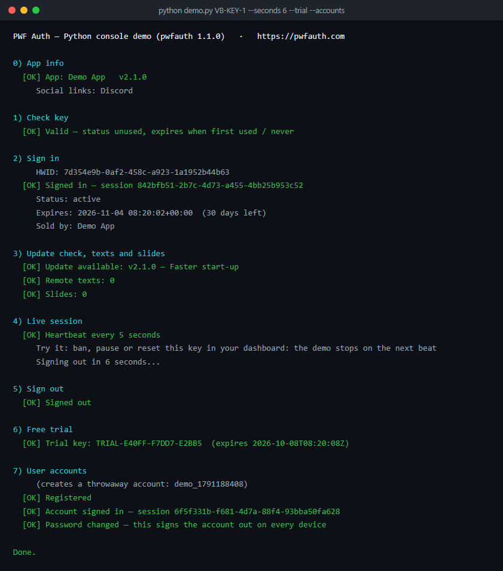

# pwfauth-python-client

A guided **console tour** of the official
[`pwfauth` Python package](https://pypi.org/project/pwfauth/) (version 1.1.0) for
[PWF Auth](https://pwfauth.com): license keys, the heartbeat and its kill switch,
moving a license to a new PC, update checks, trials and user accounts. One
numbered section per feature, with coloured results.

> Sibling projects:
> - a Tkinter desktop app: [`pwfauth-python-desktop-sample`](https://github.com/pwfauth/pwfauth-python-desktop-sample)
> - the package's own source: [`pwfauth-python`](https://github.com/pwfauth/pwfauth-python)
> - the VB.NET and C# examples: [`pwfauth-vbnet-examples`](https://github.com/pwfauth/pwfauth-vbnet-examples)



## Install

```bash
pip install -r requirements.txt   # the pwfauth package
```

Requires Python 3.9+.

## Run the demo

```bash
# Linux/macOS
export PWFAUTH_SECRET="your_app_secret"
python demo.py PWF-XXXX-XXXX-XXXX

# Windows
setx PWFAUTH_SECRET "your_app_secret"
python demo.py PWF-XXXX-XXXX-XXXX
```

Run with no argument to be prompted for the key. Options:

| Option | What it does |
| --- | --- |
| `--move` | Move the license here without asking when it is bound to another PC |
| `--seconds N` | Keep the session open N seconds instead of waiting for Enter |
| `--trial` | Also create a free trial key for this computer |
| `--accounts` | Also create a throwaway user account |

`--trial` and `--accounts` are off by default because they create data in your
application. `PWFAUTH_BASE_URL` points the demo at another server, such as a
staging copy.

Exit codes: `0` done, `1` no secret or key, `2` sign-in refused, `3` no connection
or not the license server, `4` the kill switch ended the session.

## Features demonstrated

| # | Feature | Package call |
| --- | --- | --- |
| 0 | App info: name, version, social links | `get_app_info()` |
| 1 | Check a key without using a device seat | `check_key()` |
| 2 | Sign in: bind this PC, open a session | `login()` |
| 2 | Move the license here when it is bound elsewhere | `reset_hardware_id()` |
| 3 | Update check, remote texts, slides | `check_update()`, `get_texts()`, `get_slides()` |
| 4 | The heartbeat and its kill switch | `start_heartbeat()`, `on_session_ended` |
| 5 | Sign out | `logout()` |
| 6 | Free trial (`--trial`) | `create_trial()` |
| 7 | User accounts (`--accounts`) | `register_account()`, `account_login()`, `change_account_password()` |

During section 4, ban, pause or reset the key in your dashboard: the demo stops
on the next beat, the way a real app should. The callback runs on the heartbeat
thread, so it stops the program with `os._exit()`; `sys.exit()` would only end that
thread.

## Use the package in your app

```python
import os, sys
from pwfauth import PwfClient

client = PwfClient(os.environ["PWFAUTH_SECRET"])

def on_session_ended(code, msg):   # kill switch: banned, paused, expired, reset...
    print(f"Session ended ({code}): {msg}", file=sys.stderr)
    os._exit(1)   # runs on the heartbeat thread, where sys.exit() would only end that thread

client.on_session_ended = on_session_ended

login = client.login("PWF-XXXX-XXXX-XXXX")
if not login.success:
    sys.exit(login.message)

client.start_heartbeat()   # keeps the session alive AND enforces the kill switch
```

The package also:

- corrects a wrong PC clock by itself, and moving the clock does not dodge the kill
  switch;
- refuses a reply that claims success without encryption (`PwfSecurityError`): it
  came from a proxy, a hosts-file entry or a fake server.

Full reference: [pwfauth.com/docs](https://pwfauth.com/docs).

## Files

| File | Role |
| --- | --- |
| `demo.py` | The guided tour, one function per section |
| `test_demo.py` | An offline test: a fake server's plain "success" must be refused |

## Upgrading from version 1

Version 1 of this repository was a hand-written client, `pwfauth_client.py`, built
on pycryptodome. It did not refuse a fake server's plain "success" and had no
heartbeat loop, so a ban never stopped the app. It is replaced by the official
package, which does both. The old code stays available at the
[`v1.0.0`](https://github.com/pwfauth/pwfauth-python-client/tree/v1.0.0) tag.

## Security note

An app secret shipped in a client can be extracted — treat client-side license
checks as a **deterrent, not DRM**. Keep the secret out of source control; the
demo reads it from the `PWFAUTH_SECRET` environment variable.

## License

MIT — see [LICENSE](LICENSE).
